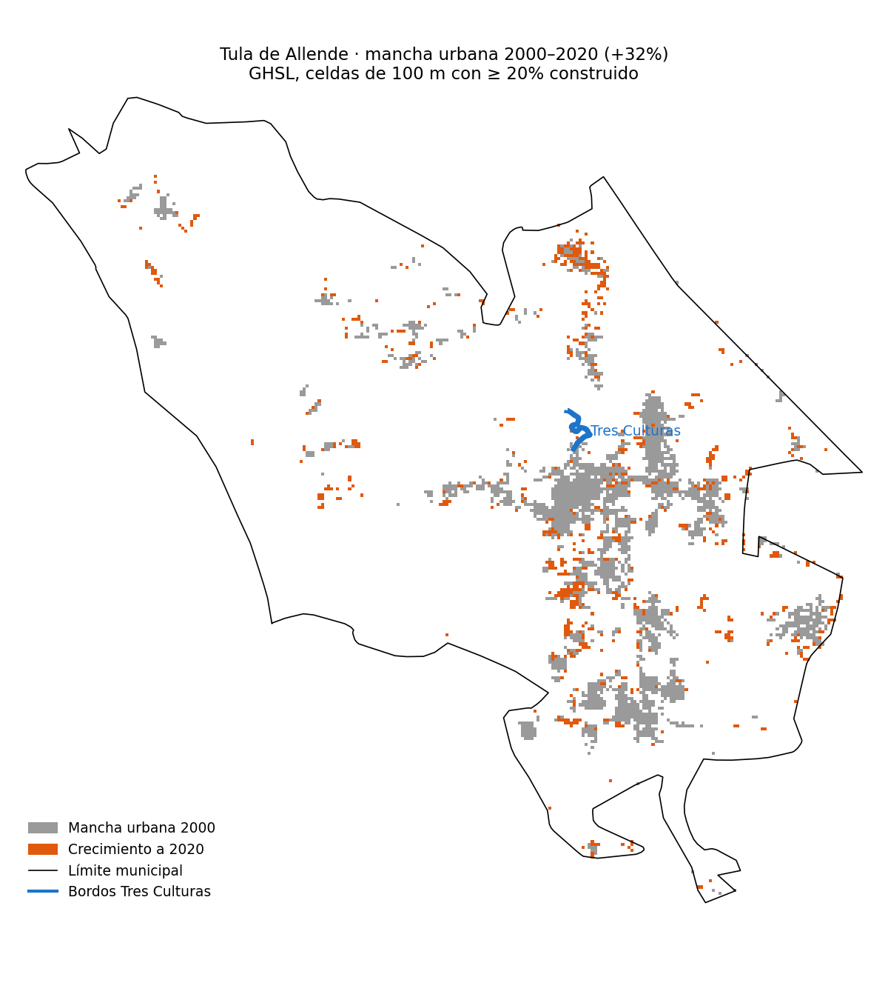

# Expansión urbana de Tula de Allende 2000–2020

Entre 2000 y 2020, la población del municipio creció 33% (INEGI) y su mancha urbana 32% (GHSL).

## Mancha urbana



## Crecimiento 2000–2020

| | 2000 | 2020 | Cambio |
|---|---:|---:|---:|
| Población (INEGI) | 86,840 hab | 115,107 hab | +32.6% |
| Superficie construida | 1,014 ha | 1,367 ha | +34.8% |
| Mancha urbana (≥ 20%) | 2,236 ha | 2,951 ha | +32.0% |

## Por año

| Año | Superficie construida (ha) | Mancha urbana (ha) |
|---|---:|---:|
| 2000 | 1,014 | 2,236 |
| 2005 | 1,057 | 2,344 |
| 2010 | 1,107 | 2,462 |
| 2015 | 1,187 | 2,579 |
| 2020 | 1,367 | 2,951 |

## Sensibilidad al umbral

| Celdas con construido ≥ | Mancha 2000 (ha) | Mancha 2020 (ha) | Cambio |
|---|---:|---:|---:|
| 10% | 3,419 | 4,438 | +29.8% |
| 20% | 2,236 | 2,951 | +32.0% |
| 30% | 1,309 | 1,841 | +40.7% |

## Método

- Superficie construida: GHSL `JRC/GHSL/P2023A/GHS_BUILT_S`, celdas de 100 m, épocas 2000–2020.
- Mancha urbana: área de las celdas con ≥ 20% de superficie construida.
- Límite: `FAO/GAUL/2025/level2`, Tula De Allende (337 km²; INEGI reporta ~305 km²). Con GAUL 2015 (491 km²) el crecimiento de la mancha es +31.7%.

## Tablas

- [Mancha urbana](resultados/mancha_urbana.csv)

## Archivos

| Archivo | Contenido |
|---|---|
| `datos/bordos.gpkg` | Bordos Tres Culturas (referencia en el mapa) |
| `gee_mancha_urbana.py` | Superficie construida, mancha urbana y mapa desde Earth Engine |

## Uso

```
pip install -r requirements.txt
python gee_mancha_urbana.py datos/bordos.gpkg bordo resultados <proyecto_gee>
```
