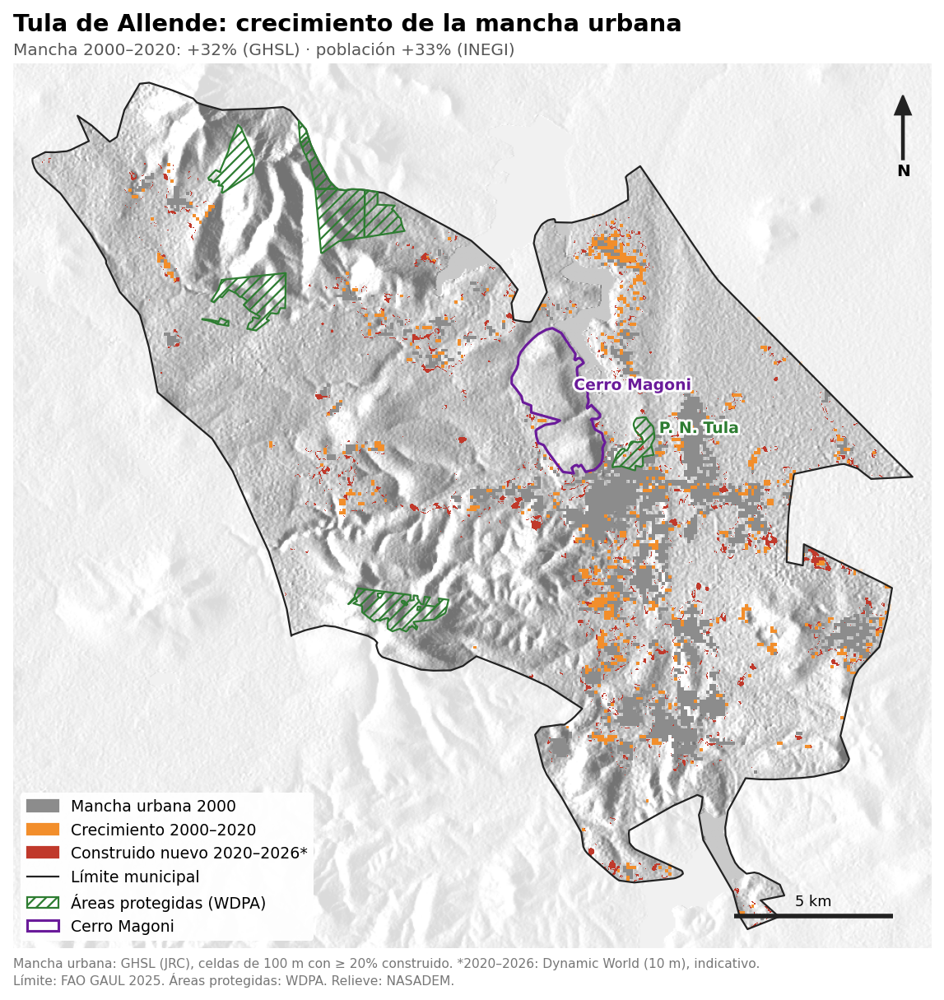

# Expansión urbana de Tula de Allende 2000–2026

Entre 2000 y 2020, la población del municipio creció 33% (INEGI) y su mancha urbana 32% (GHSL).

## Mancha urbana



## Crecimiento 2000–2020

| | 2000 | 2020 | Cambio |
|---|---:|---:|---:|
| Población (INEGI) | 86,840 hab | 115,107 hab | +32.6% |
| Superficie construida | 1,014 ha | 1,367 ha | +34.8% |
| Mancha urbana (≥ 20%) | 2,236 ha | 2,951 ha | +32.0% |

## Por año

| Año | Superficie construida (ha) | No residencial (ha) | Mancha urbana (ha) |
|---|---:|---:|---:|
| 2000 | 1,014 | 29 | 2,236 |
| 2005 | 1,057 | 30 | 2,344 |
| 2010 | 1,107 | 31 | 2,462 |
| 2015 | 1,187 | 33 | 2,579 |
| 2020 | 1,367 | 41 | 2,951 |

La superficie construida incluye uso residencial y no residencial. GHSL clasifica como no residencial solo el 3% del total, lo que subestima la refinería Miguel Hidalgo y la termoeléctrica: la mayor parte de la industria queda contada dentro de la mancha sin separarse.

## Sensibilidad al umbral

| Celdas con construido ≥ | Mancha 2000 (ha) | Mancha 2020 (ha) | Cambio |
|---|---:|---:|---:|
| 10% | 3,419 | 4,438 | +29.8% |
| 20% | 2,236 | 2,951 | +32.0% |
| 30% | 1,309 | 1,841 | +40.7% |

## 2020–2026

GHSL llega a 2020. Para los años siguientes se usa Dynamic World (10 m), que mide la clase "construido" de forma distinta, por lo que la cifra es indicativa y no se suma a la serie de GHSL.

| | 2020 | 2026 | Cambio |
|---|---:|---:|---:|
| Construido (Dynamic World) | 5,967 ha | 6,194 ha | +3.8% |

En el mapa, el rojo marca lo que pasó a construido entre 2019–2020 y 2025–2026 fuera de la mancha GHSL 2020.

## Tierra agrícola


| Cambio 2016–2017 → 2025–2026 | ha |
|---|---:|
| Cultivo que se mantiene | 6,518 |
| Cultivo nuevo | 1,035 |
| Cultivo perdido: ahora construido | 237 |
| Cultivo perdido: otro uso | 1,147 |
| **Cultivos 2016–2017 → 2025–2026** | **7,902 → 7,553 (−4.4%)** |

| Año | Cultivos (ha) | Construido (ha) |
|---|---:|---:|
| 2016 | 6,901 | 5,772 |
| 2017 | 8,563 | 6,154 |
| 2018 | 9,669 | 5,733 |
| 2019 | 9,343 | 5,985 |
| 2020 | 9,640 | 5,967 |
| 2021 | 9,899 | 6,377 |
| 2022 | 9,516 | 6,325 |
| 2023 | 10,061 | 6,135 |
| 2024 | 9,880 | 6,273 |
| 2025 | 7,681 | 6,266 |
| 2026 | 7,380 | 6,194 |

- La superficie de cultivo sube y baja con la lluvia: en años secos las parcelas de temporal no se siembran y aparecen como pastizal o suelo desnudo.
- Dynamic World subestima la agricultura: INEGI (2010) reporta 52.9% del municipio como agrícola (~17,800 ha). La tendencia es más confiable que el valor absoluto.

## Vegetación natural


La biodiversidad no se mide directamente por satélite; se usa la pérdida de hábitat natural (matorral, pastizal y árboles) como indicador.

| Cambio 2016–2017 → 2025–2026 | ha |
|---|---:|
| Vegetación natural que se mantiene | 19,108 |
| Perdida: ahora cultivo | 829 |
| Perdida: ahora construido | 362 |
| Perdida: ahora suelo desnudo o agua | 172 |
| Recuperada (antes cultivo u otro) | 1,792 |
| **Vegetación natural 2016–2017 → 2025–2026** | **20,471 → 20,901 (+2.1%)** |

- Se perdieron 1,362 ha de vegetación natural; 362 ha pasaron a zona construida, de forma permanente.
- La "recuperación" es sobre todo parcelas de temporal que no se sembraron, no regeneración de matorral.
- Pérdida de cobertura arbórea (Hansen, 2001–2025): 61 ha en total; el municipio tiene poca cobertura arbórea densa.

## Método

- Superficie construida: GHSL `JRC/GHSL/P2023A/GHS_BUILT_S`, celdas de 100 m, épocas 2000–2020.
- Mancha urbana: área de las celdas con ≥ 20% de superficie construida.
- Cobertura 2016–2026: Dynamic World `GOOGLE/DYNAMICWORLD/V1`, clase más frecuente de cada año (10 m). Los mapas comparan 2016–2017 con 2025–2026 para reducir el efecto de un solo año. 2026 hasta octubre.
- Pérdida arbórea: Hansen `UMD/hansen/global_forest_change_2025_v1_13`, banda `lossyear`.
- Áreas protegidas: WDPA. Cerro Magoni: `datos/magoni.geojson`. Relieve: NASADEM.
- Límite: `FAO/GAUL/2025/level2`, Tula De Allende (337 km²; INEGI reporta ~305 km²). Con GAUL 2015 (491 km²) el crecimiento de la mancha es +31.7%.

## Tablas

- [Mancha urbana](resultados/mancha_urbana.csv)
- [Cobertura Dynamic World por año](resultados/cobertura_dynamic_world.csv)
- [Cambio en tierra agrícola](resultados/tierra_agricola_cambio.csv)
- [Vegetación natural por año](resultados/vegetacion_natural_dw.csv)
- [Cambio en vegetación natural](resultados/vegetacion_natural_cambio.csv)
- [Pérdida arbórea por año](resultados/perdida_arboles_hansen.csv)

## Archivos

| Archivo | Contenido |
|---|---|
| `comun.py` | Límite municipal, Dynamic World y mapa base compartido |
| `gee_mancha_urbana.py` | Superficie construida, mancha urbana 2000–2020 y construido 2020–2026 |
| `gee_tierra_agricola.py` | Tendencia y cambio de la tierra agrícola 2016–2026 |
| `gee_vegetacion_natural.py` | Tendencia y pérdida de vegetación natural 2016–2026 |
| `datos/magoni.geojson` | Polígono del Cerro Magoni |

## Uso

```
pip install -r requirements.txt
python gee_mancha_urbana.py datos/magoni.geojson resultados <proyecto_gee>
python gee_tierra_agricola.py datos/magoni.geojson resultados <proyecto_gee>
python gee_vegetacion_natural.py datos/magoni.geojson resultados <proyecto_gee>
```
